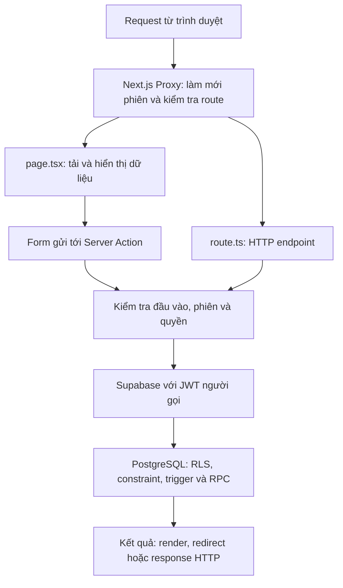

# Bản đồ source và trách nhiệm từng file trong IDAILY

Tài liệu mô tả cây dự án trên nhánh `docs/source-guide`, kế thừa nhánh
`refactor/source-readability` tại commit `474be07`. Mục tiêu là giúp người mới biết
luồng xử lý nằm ở đâu và nên mở file nào khi cần đọc hoặc bảo trì một chức năng.
Các bảng bên dưới bao phủ toàn bộ file được Git quản lý trong bản source này;
file sinh ra khi chạy ứng dụng được giải thích riêng ở cuối tài liệu.

Đây là hướng dẫn đọc implementation hiện có. Yêu cầu nghiệp vụ phải đối chiếu
[báo cáo gốc](source/Bao-cao-mon-opensource.pdf), [hướng dẫn tài liệu gốc](source/README.md)
và [nhật ký quyết định](business-change-log.md). Các báo cáo nghiệm thu trong `docs/`
ghi nhận bằng chứng ở thời điểm tương ứng, không tự chứng minh tình trạng hiện tại.

## 1. Cách đọc dự án

Ứng dụng dùng Next.js App Router, React, TypeScript và Supabase. Phần giao diện,
Server Action và HTTP endpoint cùng nằm trong dự án Next.js; quy tắc truy cập hàng
dữ liệu, trigger và các thao tác RPC nằm ở PostgreSQL qua migration Supabase.

Nên đọc theo thứ tự:

1. `README.md` để biết cách chạy và biến môi trường cần cấu hình.
2. `src/app/layout.tsx` → `src/components/app-frame.tsx` để hiểu khung trang.
3. `src/proxy.ts` → `src/lib/supabase/proxy.ts` để hiểu cookie/route đăng nhập.
4. `page.tsx` của chức năng → `actions.ts` hoặc `route.ts` tương ứng để theo luồng dữ liệu.
5. Guard ở `src/lib/`, client Supabase và migration chứa RPC/policy liên quan.
6. Test tương ứng và [danh mục hợp đồng action/API](action-contracts.md) trước khi sửa hành vi.



Các component client như `AppFrame` cũng đọc Supabase để dựng ngữ cảnh UI.
Luồng đăng ký/đăng nhập có client đặc quyền riêng ở server cho các bước precheck
và đọc trạng thái; xem ranh giới client ở phần 3.

## 2. Quy ước tên file

| Tên/đuôi | Ý nghĩa trong dự án |
| --- | --- |
| `page.tsx` | Trang React tương ứng với URL của thư mục trong App Router. |
| `layout.tsx` | Khung bọc các trang con. Layout gốc khai báo `html`/`body`. |
| `actions.ts` | Tên dự án dùng cho Server Action. Chỉ thị `"use server"` đánh dấu module chạy phía server. |
| `route.ts` | HTTP endpoint như callback hoặc xuất CSV; export hàm theo phương thức HTTP. |
| `loading.tsx`, `error.tsx` | Boundary tải/lỗi của đoạn route. `error.tsx` là client component để gọi `reset`. |
| `global-error.tsx`, `not-found.tsx` | Dự phòng lỗi layout gốc và trang không tìm thấy. |
| `[id]/` | Tham số route động, được trang đọc qua `params`; tên thư mục không phải id cố định. |
| `.ts` | Logic hoặc khai báo kiểu TypeScript không chứa JSX. |
| `.tsx` | Module TypeScript có JSX, thường là trang/component. Mặc định App Router dùng server component nếu không có `"use client"`. |
| `.mjs` | JavaScript ES module, dùng cho các hàm thuần/luồng có adapter để Node test trực tiếp. |
| `.d.mts` | Khai báo kiểu cho module `.mjs` cùng tên; không chứa implementation chạy thực tế. |
| `.cjs` | CommonJS; dự án hiện dùng cho các script kiểm thử trình duyệt. |
| `.sql` | Migration hoặc pgTAP, tùy thư mục chứa file. |

## 3. Ranh giới và các luồng cần nắm

### Client, server và quyền truy cập

- `src/lib/supabase/client.ts`: client trong trình duyệt, dùng cấu hình công khai.
- `src/lib/supabase/server.ts`: client theo cookie của request; query/RPC mang quyền người dùng.
- `src/lib/supabase/admin.ts`: client đặc quyền có thể vượt RLS, chỉ dùng ở server
  trong các bước Auth được kiểm soát. CRUD thông thường dùng client theo phiên.
- Proxy kiểm tra route và refresh cookie; trang/action dùng guard để kiểm tra phiên/vai trò.
  Việc ẩn menu hoặc khóa nút ở UI không thay thế kiểm tra quyền trong database.
- `requireBusinessAccount` kiểm tra claims và hồ sơ tồn tại, không tự kiểm tra trạng
  thái hoạt động. `requireActiveBusinessAccount` bổ sung kiểm tra trạng thái tường minh.
- `requireManager` cần DM/UM. `requireDm` cần DM cùng quyền `NOTIFICATION_MANAGE`.
  `requireAdmin` cần ADMIN. Dữ liệu/trạng thái còn chịu RLS và kiểm tra trong RPC.

RLS (Row Level Security) là policy PostgreSQL quyết định người gọi được đọc/ghi
dòng nào. RPC là function database được gọi qua Supabase API; các RPC nghiệp vụ
kiểm tra quyền/trạng thái tại nơi thay đổi dữ liệu, nhiều thao tác chạy trong cùng
transaction để giữ dữ liệu nhất quán.

### Đăng ký, đăng nhập và mật khẩu

- Form gọi `src/app/auth/actions.ts`. File này cung cấp adapter Supabase cho
  `auth-registration.mjs` và `auth-login-flow.mjs`; các module luồng trả URL kết quả,
  còn Server Action thực hiện `redirect`.
- Đăng ký kiểm tra người quản lý và các định danh trước khi sign-up; trigger
  database vẫn là nơi xác minh/cấp hồ sơ SA cuối cùng, kể cả khi có request đồng thời.
- Đăng nhập phải qua cả xác thực mật khẩu và trạng thái hồ sơ. Nếu Auth đã tạo
  phiên nhưng hồ sơ không được vào ứng dụng, luồng cố gắng dọn phiên cục bộ.
- Callback xác nhận email và phiên recovery là các bước Auth riêng; người dùng
  vẫn phải đi qua đăng nhập bằng mật khẩu và điều kiện trạng thái tài khoản.
- Đổi mật khẩu trong phiên dùng nonce OTP xác thực lại; khôi phục dùng OTP loại
  `recovery`. Sau khi đổi thành công, các action kết thúc phiên cục bộ.

### Form và lưu nháp

- `GuardedForm` chặn gửi lặp từ cả nhấp đúp và Enter; `PendingSubmitButton` thể hiện
  trạng thái đang gửi và hỗ trợ xác nhận thao tác khi trang yêu cầu.
- `FormDraftPersistence` lưu vào `sessionStorage` theo khóa gồm tài khoản + form/bản ghi.
  Password, OTP, token, trường ẩn và các control nhạy cảm không được lưu.
- Bản nháp chỉ phục hồi sau khi kiểm tra phiên bản, kiểu và giới hạn dữ liệu;
  không ghi đè giá trị người dùng đã nhập trước khi effect hoạt động.
- `SearchableCheckboxPicker` nhận sự kiện khôi phục để đồng bộ DOM và state React.
  `FormDraftClear` xóa nháp khi trang xác nhận thành công; `DraftCancelLink` xóa khi hủy.

### Khách hàng, thông báo và báo cáo

- Mã khách hàng do sequence/trigger tạo; form không nhận mã từ người dùng.
  `createCustomer` chỉ retry khi trùng đúng constraint mã khách hàng.
- Thông báo được tạo thành nháp, sau đó gửi bằng action riêng. Sửa/xóa/gửi gọi RPC
  để kiểm tra chủ sở hữu và trạng thái tại thời điểm ghi dữ liệu.
- `resolveReportRange` tính lịch Việt Nam; khoảng RPC là `[start, end)`, gồm đầu
  khoảng và loại đầu kỳ kế tiếp. Tuần bắt đầu thứ Hai.
- Bảng, tổng số, biểu đồ, xếp hạng dùng cùng các dòng từ `report_scope`.
  Export CSV dùng cùng RPC/khoảng, tự trả 401/403 và escape dữ liệu bảng tính.

## 4. Nhiệm vụ từng thư mục

Các thư mục route trung gian không có `page.tsx` chỉ nhóm các route con; việc có
thư mục không đồng nghĩa URL gốc của thư mục đó có một trang riêng.

| Thư mục | Nhiệm vụ |
| --- | --- |
| [.github/](../.github) | Quy trình cộng tác và tự động kiểm tra trên GitHub. |
| [.github/workflows/](../.github/workflows) | Các workflow GitHub Actions cho ứng dụng và database. |
| [docs/](.) | Tài liệu kiến trúc, hợp đồng, đánh giá, kế hoạch nghiệm thu và triển khai. |
| [docs/source/](source) | Tài liệu nghiệp vụ gốc và hướng dẫn đối chiếu yêu cầu. |
| [scripts/](../scripts) | Script hỗ trợ phát triển/CI, không tham gia xử lý request nghiệp vụ. |
| [src/](../src) | Source chính của ứng dụng Next.js. |
| [src/app/](../src/app) | App Router: trang, layout, boundary tải/lỗi, Server Action và Route Handler. |
| [src/app/access-denied/](../src/app/access-denied) | Trang thông báo thiếu quyền truy cập. |
| [src/app/activities/](../src/app/activities) | Danh sách, tạo, sửa và xử lý ghi dữ liệu hoạt động kinh doanh. |
| [src/app/activities/[id]/](../src/app/activities/%5Bid%5D) | Nhóm route thao tác một hoạt động theo tham số id; hiện chỉ có trang sửa. |
| [src/app/activities/[id]/edit/](../src/app/activities/%5Bid%5D/edit) | Trang form sửa hoạt động của người dùng hiện tại. |
| [src/app/activities/new/](../src/app/activities/new) | Trang form tạo hoạt động. |
| [src/app/admin/](../src/app/admin) | Khu vực quản trị tài khoản và vai trò, có guard ADMIN trong từng trang/action. |
| [src/app/admin/accounts/](../src/app/admin/accounts) | Tra cứu danh sách tài khoản dành cho ADMIN. |
| [src/app/admin/accounts/[id]/](../src/app/admin/accounts/%5Bid%5D) | Chi tiết và các thao tác quản trị trên một tài khoản. |
| [src/app/admin/roles/](../src/app/admin/roles) | Danh mục vai trò và Server Action quản lý tập quyền. |
| [src/app/admin/roles/[id]/](../src/app/admin/roles/%5Bid%5D) | Nhóm route của một vai trò theo id; hiện có trang sửa tập quyền. |
| [src/app/admin/roles/[id]/edit/](../src/app/admin/roles/%5Bid%5D/edit) | Trang sửa quyền của vai trò được cho phép chỉnh. |
| [src/app/admin/roles/new/](../src/app/admin/roles/new) | Trang tạo vai trò tùy chỉnh. |
| [src/app/auth/](../src/app/auth) | Các Server Action liên quan Auth và callback xác nhận email. |
| [src/app/auth/callback/](../src/app/auth/callback) | HTTP endpoint nhận code từ luồng xác nhận email. |
| [src/app/customers/](../src/app/customers) | Tra cứu, tạo, xem, sửa, xóa hồ sơ khách hàng. |
| [src/app/customers/[id]/](../src/app/customers/%5Bid%5D) | Trang chi tiết và nhánh sửa một khách hàng. |
| [src/app/customers/[id]/edit/](../src/app/customers/%5Bid%5D/edit) | Trang form sửa khách hàng. |
| [src/app/customers/new/](../src/app/customers/new) | Trang form tạo khách hàng. |
| [src/app/dashboard/](../src/app/dashboard) | Trang tổng quan và số liệu công việc theo quyền. |
| [src/app/login/](../src/app/login) | Trang đăng nhập công khai. |
| [src/app/notifications/](../src/app/notifications) | Hộp thông báo, quản lý nháp, gửi và đánh dấu đã đọc. |
| [src/app/notifications/[id]/](../src/app/notifications/%5Bid%5D) | Nhóm route của một thông báo; hiện chỉ có trang sửa nháp. |
| [src/app/notifications/[id]/edit/](../src/app/notifications/%5Bid%5D/edit) | Trang sửa bản nháp thông báo của người tạo. |
| [src/app/notifications/new/](../src/app/notifications/new) | Trang soạn bản nháp và chọn người nhận. |
| [src/app/password/](../src/app/password) | Nhóm route đổi và khôi phục mật khẩu, không có trang gốc riêng. |
| [src/app/password/change/](../src/app/password/change) | Đổi mật khẩu trong phiên hoạt động, cần OTP xác thực lại. |
| [src/app/password/recovery/](../src/app/password/recovery) | Yêu cầu OTP khôi phục khi quên mật khẩu. |
| [src/app/password/recovery/verify/](../src/app/password/recovery/verify) | Xác minh OTP khôi phục và đặt mật khẩu mới. |
| [src/app/personnel/](../src/app/personnel) | Cây nhân sự và chi tiết/tổng hợp cho người quản lý. |
| [src/app/personnel/[id]/](../src/app/personnel/%5Bid%5D) | Chi tiết một nhân sự trong phạm vi quản lý. |
| [src/app/profile/](../src/app/profile) | Xem và tự cập nhật các trường hồ sơ được cho phép. |
| [src/app/register/](../src/app/register) | Trang tự đăng ký đại lý SA. |
| [src/app/reports/](../src/app/reports) | Báo cáo theo thời gian, biểu đồ/xếp hạng và boundary riêng. |
| [src/app/reports/export/](../src/app/reports/export) | Endpoint xuất báo cáo CSV có xác thực và phạm vi người gọi. |
| [src/components/](../src/components) | UI dùng chung, khung ứng dụng và hành vi form phía client. |
| [src/lib/](../src/lib) | Guard truy cập, hàm nghiệp vụ/validation thuần và adapter hạ tầng. |
| [src/lib/supabase/](../src/lib/supabase) | Factory client, cấu hình, cookie/session và quy tắc route cho Supabase. |
| [supabase/](../supabase) | Cấu hình Auth/database local, lịch sử schema và kiểm thử database/API. |
| [supabase/migrations/](../supabase/migrations) | Các thay đổi schema/RLS/function theo timestamp; trạng thái cuối là kết quả áp dụng theo thứ tự. |
| [supabase/templates/](../supabase/templates) | Template email OTP khôi phục và xác thực lại. |
| [supabase/tests/](../supabase/tests) | Các bộ kiểm thử cần Supabase/database thực. |
| [supabase/tests/auth/](../supabase/tests/auth) | Integration test Node.js gọi Auth/Data API với JWT thật. |
| [supabase/tests/database/](../supabase/tests/database) | pgTAP kiểm tra schema, RLS, RPC, trigger và quyền SQL. |
| [tests/](../tests) | Unit/contract test bằng node:test và các script trình duyệt Playwright. |

## 5. Nhiệm vụ từng file

Mỗi bảng ghi tên file tương đối với thư mục trong tiêu đề; bấm tên file để mở
source. Cặp `.mjs`/`.d.mts` được liệt kê riêng để thấy cả implementation và hợp đồng kiểu.
Migration cũ ghi lại bước thay đổi tại thời điểm tạo; muốn biết trạng thái hiện tại
phải đọc cả các migration phía sau, đặc biệt những file `repair_*`.

### Thư mục gốc

| File | Nhiệm vụ |
| --- | --- |
| [.env.example](../.env.example) | Mẫu tên biến môi trường cho ứng dụng; sao chép sang cấu hình cục bộ/deployment và điền giá trị phù hợp, không commit secret. |
| [.gitignore](../.gitignore) | Quy định các thư mục build, dependency, file môi trường và dữ liệu máy cá nhân không đưa vào Git. |
| [PROJECT_PLAN.md](../PROJECT_PLAN.md) | Kế hoạch triển khai, phạm vi và các quyết định dẫn xuất từ tài liệu nghiệp vụ gốc. |
| [README.md](../README.md) | Điểm bắt đầu: mô tả IDAILY, tài liệu nghiệp vụ gốc, stack, cách chạy và các liên kết hướng dẫn. |
| [eslint.config.mjs](../eslint.config.mjs) | Cấu hình ESLint theo Next.js Core Web Vitals/TypeScript và loại trừ các thư mục build. |
| [next-env.d.ts](../next-env.d.ts) | Khai báo kiểu môi trường Next.js do framework sinh; không đặt logic ứng dụng hoặc chỉnh thủ công tại đây. |
| [next.config.ts](../next.config.ts) | Điểm khai báo cấu hình Next.js; hiện dùng cấu hình rỗng với hành vi mặc định của framework. |
| [package-lock.json](../package-lock.json) | Khóa cây dependency npm để npm ci cài lại cùng phiên bản; không sửa thủ công. |
| [package.json](../package.json) | Khai báo dependency và các lệnh dev/build/lint/type-check/test/security của ứng dụng. |
| [tsconfig.json](../tsconfig.json) | Cấu hình TypeScript strict, module resolution và alias @/* trỏ đến src/*. |

### `.github/`

| File | Nhiệm vụ |
| --- | --- |
| [pull_request_template.md](../.github/pull_request_template.md) | Mẫu mô tả PR để người triển khai ghi thay đổi, cách kiểm chứng và các điểm reviewer cần chú ý. |

### `.github/workflows/`

| File | Nhiệm vụ |
| --- | --- |
| [ci.yml](../.github/workflows/ci.yml) | CI trên PR và push vào main: cài dependency, audit production dependency, lint, type-check, contract test, kiểm tra secret và build. |
| [database-tests.yml](../.github/workflows/database-tests.yml) | CI Supabase local: reset migration/seed, chạy pgTAP và Auth integration, route smoke, form browser checks và chụp ảnh nghiệm thu. |

### `src/`

| File | Nhiệm vụ |
| --- | --- |
| [proxy.ts](../src/proxy.ts) | Điểm vào Proxy của Next.js: chuyển các request phù hợp sang bước làm mới phiên và kiểm tra route đăng nhập. |

### `src/app/`

| File | Nhiệm vụ |
| --- | --- |
| [error.tsx](../src/app/error.tsx) | Màn hình dự phòng khi một trang bên dưới layout gặp lỗi; cho phép gọi reset để thử render lại. |
| [global-error.tsx](../src/app/global-error.tsx) | Màn hình dự phòng cho lỗi ở layout gốc; tự dựng lại html/body vì layout thông thường không còn dùng được. |
| [globals.css](../src/app/globals.css) | Kiểu nền tảng toàn ứng dụng: biến thiết kế, trang công khai, form, bảng, trạng thái UI và các điều chỉnh responsive dùng chung. |
| [layout.tsx](../src/app/layout.tsx) | Layout gốc: khai báo metadata, ngôn ngữ tiếng Việt, nạp CSS chung và bọc nội dung trang trong AppFrame. |
| [loading.tsx](../src/app/loading.tsx) | Giao diện chờ mặc định của App Router trong lúc nội dung route đang được tải. |
| [not-found.tsx](../src/app/not-found.tsx) | Trang 404 dùng khi route hoặc bản ghi mà trang yêu cầu không tồn tại. |
| [page.tsx](../src/app/page.tsx) | Trang giới thiệu công khai của IDAILY, cung cấp lối vào đăng nhập và đăng ký đại lý. |
| [workspace.css](../src/app/workspace.css) | Kiểu dành cho khu vực làm việc: sidebar, thanh đầu trang, menu tài khoản, dashboard và bố cục hồ sơ trên các kích thước màn hình. |

### `src/app/access-denied/`

| File | Nhiệm vụ |
| --- | --- |
| [page.tsx](../src/app/access-denied/page.tsx) | Trang giải thích việc truy cập bị từ chối và cung cấp đường quay về cho người dùng. |

### `src/app/activities/`

| File | Nhiệm vụ |
| --- | --- |
| [actions.ts](../src/app/activities/actions.ts) | Server Action kiểm tra dữ liệu hoạt động, chuẩn hóa thời gian và tạo/sửa/xóa với tài khoản lấy từ phiên đăng nhập. |
| [page.tsx](../src/app/activities/page.tsx) | Danh sách hoạt động trong phạm vi được cấp quyền, có bộ lọc, phân trang, tên người thực hiện và thao tác xóa hoạt động của mình. |

### `src/app/activities/[id]/edit/`

| File | Nhiệm vụ |
| --- | --- |
| [page.tsx](../src/app/activities/%5Bid%5D/edit/page.tsx) | Form sửa hoạt động của chính tài khoản hiện tại; chuyển thời gian đã lưu thành giờ Việt Nam cho input datetime-local. |

### `src/app/activities/new/`

| File | Nhiệm vụ |
| --- | --- |
| [page.tsx](../src/app/activities/new/page.tsx) | Form ghi nhận hoạt động kinh doanh, địa điểm, thời gian và số lượt khách kết nối; hỗ trợ lưu nháp. |

### `src/app/admin/`

| File | Nhiệm vụ |
| --- | --- |
| [actions.ts](../src/app/admin/actions.ts) | Server Action quản trị tài khoản qua các RPC có kiểm tra quyền trong database; làm mới các trang liên quan sau khi thành công. |

### `src/app/admin/accounts/`

| File | Nhiệm vụ |
| --- | --- |
| [page.tsx](../src/app/admin/accounts/page.tsx) | Trang ADMIN tra cứu, lọc trạng thái và phân trang danh sách tài khoản. |

### `src/app/admin/accounts/[id]/`

| File | Nhiệm vụ |
| --- | --- |
| [page.tsx](../src/app/admin/accounts/%5Bid%5D/page.tsx) | Trang ADMIN xem chi tiết tài khoản, phê duyệt/khóa/mở khóa và gán/thu hồi vai trò. |

### `src/app/admin/roles/`

| File | Nhiệm vụ |
| --- | --- |
| [actions.ts](../src/app/admin/roles/actions.ts) | Server Action tạo vai trò tùy chỉnh hoặc cập nhật vai trò bằng RPC; kiểm tra mã vai trò và danh sách UUID quyền trước khi gọi. |
| [page.tsx](../src/app/admin/roles/page.tsx) | Trang ADMIN xem danh mục vai trò, quyền được gán và số tài khoản theo vai trò; cung cấp lối vào tạo/sửa. |

### `src/app/admin/roles/[id]/edit/`

| File | Nhiệm vụ |
| --- | --- |
| [page.tsx](../src/app/admin/roles/%5Bid%5D/edit/page.tsx) | Form ADMIN chỉnh tập quyền của vai trò; giữ thông tin định danh chỉ đọc và không cho mở sửa vai trò ADMIN. |

### `src/app/admin/roles/new/`

| File | Nhiệm vụ |
| --- | --- |
| [page.tsx](../src/app/admin/roles/new/page.tsx) | Form ADMIN tạo vai trò tùy chỉnh và chọn tập quyền, có tìm kiếm/nhóm quyền và lưu nháp. |

### `src/app/auth/`

| File | Nhiệm vụ |
| --- | --- |
| [actions.ts](../src/app/auth/actions.ts) | Các Server Action nối form với Supabase Auth: đăng ký, đăng nhập, OTP đổi/khôi phục mật khẩu và đăng xuất. |

### `src/app/auth/callback/`

| File | Nhiệm vụ |
| --- | --- |
| [route.ts](../src/app/auth/callback/route.ts) | Nhận authorization code từ email xác nhận, đổi code lấy phiên tạm rồi đăng xuất để quay lại luồng đăng nhập thông thường. |

### `src/app/customers/`

| File | Nhiệm vụ |
| --- | --- |
| [actions.ts](../src/app/customers/actions.ts) | Server Action kiểm tra dữ liệu và tạo/sửa/xóa khách hàng; database quản lý mã khách hàng và quyền thao tác trên bản ghi. |
| [page.tsx](../src/app/customers/page.tsx) | Danh sách khách hàng theo RLS: tìm kiếm, lọc loại/trạng thái/nhóm tính cách và phân trang trên máy chủ. |

### `src/app/customers/[id]/`

| File | Nhiệm vụ |
| --- | --- |
| [page.tsx](../src/app/customers/%5Bid%5D/page.tsx) | Trang chi tiết khách hàng được phép xem, hiển thị mã do database sinh và các thao tác sửa/xóa. |

### `src/app/customers/[id]/edit/`

| File | Nhiệm vụ |
| --- | --- |
| [page.tsx](../src/app/customers/%5Bid%5D/edit/page.tsx) | Tải khách hàng theo id để điền form sửa; giữ mã khách hàng cố định và gửi phần dữ liệu cho phép tới updateCustomer. |

### `src/app/customers/new/`

| File | Nhiệm vụ |
| --- | --- |
| [page.tsx](../src/app/customers/new/page.tsx) | Form tạo hồ sơ khách hàng, lưu nháp trong phiên trình duyệt và gửi dữ liệu tới createCustomer. |

### `src/app/dashboard/`

| File | Nhiệm vụ |
| --- | --- |
| [page.tsx](../src/app/dashboard/page.tsx) | Trang tổng quan: tải số liệu theo phạm vi truy cập, việc cần xử lý và hoạt động gần đây; bổ sung số tài khoản cho ADMIN. |

### `src/app/login/`

| File | Nhiệm vụ |
| --- | --- |
| [page.tsx](../src/app/login/page.tsx) | Form đăng nhập email/mật khẩu; đọc mã lỗi và trạng thái trên URL để hiển thị phản hồi từ Server Action. |

### `src/app/notifications/`

| File | Nhiệm vụ |
| --- | --- |
| [actions.ts](../src/app/notifications/actions.ts) | Server Action tạo/sửa/xóa/gửi bản nháp qua RPC; người nhận chỉ đánh dấu đã đọc trên dòng thuộc tài khoản mình. |
| [page.tsx](../src/app/notifications/page.tsx) | Danh sách thông báo theo phạm vi truy cập, kèm lọc/phân trang, trạng thái người nhận và thao tác bản nháp/gửi/đánh dấu đã đọc. |

### `src/app/notifications/[id]/edit/`

| File | Nhiệm vụ |
| --- | --- |
| [page.tsx](../src/app/notifications/%5Bid%5D/edit/page.tsx) | Form sửa nội dung/người nhận của bản nháp do chính DM tạo; không mở form cho thông báo đã gửi. |

### `src/app/notifications/new/`

| File | Nhiệm vụ |
| --- | --- |
| [page.tsx](../src/app/notifications/new/page.tsx) | Form để DM có quyền quản lý thông báo soạn bản nháp và chọn người nhận trong phạm vi được phép. |

### `src/app/password/change/`

| File | Nhiệm vụ |
| --- | --- |
| [page.tsx](../src/app/password/change/page.tsx) | Trang đổi mật khẩu cho tài khoản đang hoạt động, gồm yêu cầu OTP xác thực lại và gửi mật khẩu mới kèm OTP. |

### `src/app/password/recovery/`

| File | Nhiệm vụ |
| --- | --- |
| [page.tsx](../src/app/password/recovery/page.tsx) | Form công khai yêu cầu gửi email OTP để khôi phục mật khẩu. |

### `src/app/password/recovery/verify/`

| File | Nhiệm vụ |
| --- | --- |
| [page.tsx](../src/app/password/recovery/verify/page.tsx) | Form xác minh email/OTP khôi phục và đặt mật khẩu mới; chuyển dữ liệu tới verifyRecoveryOtp. |

### `src/app/personnel/`

| File | Nhiệm vụ |
| --- | --- |
| [page.tsx](../src/app/personnel/page.tsx) | Trang cây nhân sự cho DM/UM: dựng cây từ các tài khoản RLS cho phép đọc và giữ tổ tiên khi lọc kết quả tìm kiếm. |

### `src/app/personnel/[id]/`

| File | Nhiệm vụ |
| --- | --- |
| [page.tsx](../src/app/personnel/%5Bid%5D/page.tsx) | Trang thông tin nhân sự trong phạm vi quản lý và số liệu tổng hợp lấy qua RPC personnel_summary. |

### `src/app/profile/`

| File | Nhiệm vụ |
| --- | --- |
| [actions.ts](../src/app/profile/actions.ts) | Server Action cập nhật họ tên và số điện thoại của tài khoản trong phiên; chuyển lỗi database thành mã phản hồi cho trang hồ sơ. |
| [page.tsx](../src/app/profile/page.tsx) | Trang hồ sơ của tài khoản đang hoạt động: hiển thị vai trò/người quản lý và form sửa họ tên, số điện thoại của chính mình. |

### `src/app/register/`

| File | Nhiệm vụ |
| --- | --- |
| [page.tsx](../src/app/register/page.tsx) | Form tự đăng ký đại lý SA, gồm mã đại lý và mã người quản lý; hiển thị kết quả đăng ký hoặc yêu cầu xác nhận email. |

### `src/app/reports/`

| File | Nhiệm vụ |
| --- | --- |
| [error.tsx](../src/app/reports/error.tsx) | Màn hình lỗi riêng cho báo cáo, cho phép thử lại và không đưa số liệu thay thế khi dữ liệu chưa được xác nhận. |
| [loading.tsx](../src/app/reports/loading.tsx) | Giao diện chờ riêng cho khu vực báo cáo, hiển thị khung tải trong lúc trang đang lấy số liệu. |
| [page.tsx](../src/app/reports/page.tsx) | Trang báo cáo ngày/tuần/tháng: dùng dữ liệu report_scope cho tổng hợp, biểu đồ so sánh, bảng xếp hạng và liên kết xuất CSV. |

### `src/app/reports/export/`

| File | Nhiệm vụ |
| --- | --- |
| [route.ts](../src/app/reports/export/route.ts) | Route tải báo cáo CSV theo cùng khoảng thời gian và RPC với trang báo cáo; trả HTTP 401/403 khi xác thực/phạm vi bị từ chối. |

### `src/components/`

| File | Nhiệm vụ |
| --- | --- |
| [action-feedback.tsx](../src/components/action-feedback.tsx) | Hiển thị phản hồi thành công/lỗi thống nhất từ mã URL, dùng role và aria-live phù hợp để trình đọc màn hình thông báo. |
| [app-frame.tsx](../src/components/app-frame.tsx) | Khung client cho khu vực làm việc: điều hướng theo vai trò, breadcrumb, ngữ cảnh tài khoản và menu mobile có quản lý focus. |
| [draft-cancel-link.tsx](../src/components/draft-cancel-link.tsx) | Liên kết hủy form: xóa đúng bản nháp của tài khoản/form khi điều hướng thông thường, giữ hành vi mở tab mới của trình duyệt. |
| [empty-state.tsx](../src/components/empty-state.tsx) | Khối thông báo danh sách trống, có mô tả và liên kết hành động tùy chọn. |
| [error-state.tsx](../src/components/error-state.tsx) | Khối lỗi dùng chung với nội dung an toàn, nút thử lại tùy chọn và liên kết quay về. |
| [form-draft-clear.tsx](../src/components/form-draft-clear.tsx) | Component không hiển thị UI, xóa các bản nháp được chỉ định khi trang xác nhận thao tác đã thành công. |
| [form-draft-persistence.tsx](../src/components/form-draft-persistence.tsx) | Lưu/khôi phục trường form không nhạy cảm trong sessionStorage theo tài khoản và form; bỏ qua mật khẩu, OTP, token và trường ẩn. |
| [guarded-form.tsx](../src/components/guarded-form.tsx) | Form phía client khóa submit đồng bộ để chặn gửi lặp từ nhấp đúp/phím Enter; mở lại khi action hoàn tất mà không điều hướng. |
| [list-controls.tsx](../src/components/list-controls.tsx) | Các khối dùng chung cho tổng số kết quả, bộ lọc đang áp dụng và liên kết phân trang giữ nguyên tham số lọc. |
| [loading-state.tsx](../src/components/loading-state.tsx) | Nhãn trạng thái tải dùng chung để thông báo ứng dụng đang chờ dữ liệu. |
| [page-header.tsx](../src/components/page-header.tsx) | Tiêu đề trang thống nhất gồm tên trang, mô tả và vùng chứa các hành động tùy chọn. |
| [pending-submit-button.tsx](../src/components/pending-submit-button.tsx) | Nút submit đọc trạng thái form để khóa/đổi nhãn khi đang gửi và hỏi xác nhận nếu được truyền confirmMessage. |
| [public-header.tsx](../src/components/public-header.tsx) | Header các trang công khai, chọn liên kết trang chủ/đăng nhập/đăng ký theo trang đang hiển thị. |
| [searchable-checkbox-picker.tsx](../src/components/searchable-checkbox-picker.tsx) | Bộ chọn nhiều mục có tìm kiếm/nhóm, giữ lựa chọn khi lọc, kiểm tra lựa chọn bắt buộc và đồng bộ sau khi khôi phục nháp. |
| [status-badge.tsx](../src/components/status-badge.tsx) | Chuyển mã trạng thái/loại dữ liệu thành nhãn tiếng Việt và màu hiển thị; có cách hiển thị dự phòng cho mã chưa biết. |

### `src/lib/`

| File | Nhiệm vụ |
| --- | --- |
| [admin.ts](../src/lib/admin.ts) | Guard phía server cho ADMIN: xác thực claims và đọc vai trò của tài khoản trước khi trả Supabase client cùng accountId. |
| [agency-profile-validation.d.mts](../src/lib/agency-profile-validation.d.mts) | Khai báo kiểu TypeScript cho agency-profile-validation.mjs; mô tả đầu vào/kết quả của module JavaScript và cần đồng bộ khi thay đổi API của module đó. |
| [agency-profile-validation.mjs](../src/lib/agency-profile-validation.mjs) | Kiểm tra họ tên và số điện thoại được phép tự sửa trong hồ sơ; trả kết quả hoặc mã lỗi để Server Action xử lý. |
| [auth-callback-url.d.mts](../src/lib/auth-callback-url.d.mts) | Khai báo kiểu TypeScript cho auth-callback-url.mjs; mô tả đầu vào/kết quả của module JavaScript và cần đồng bộ khi thay đổi API của module đó. |
| [auth-callback-url.mjs](../src/lib/auth-callback-url.mjs) | Chọn origin callback từ cấu hình site/Vercel, hỗ trợ preview và từ chối cấu hình localhost trong production. |
| [auth-login-errors.d.mts](../src/lib/auth-login-errors.d.mts) | Khai báo kiểu TypeScript cho auth-login-errors.mjs; mô tả đầu vào/kết quả của module JavaScript và cần đồng bộ khi thay đổi API của module đó. |
| [auth-login-errors.mjs](../src/lib/auth-login-errors.mjs) | Phân loại lỗi đăng nhập, ánh xạ mã phản hồi công khai và tạo log chỉ chứa các trường chẩn đoán được giới hạn. |
| [auth-login-flow.d.mts](../src/lib/auth-login-flow.d.mts) | Khai báo kiểu TypeScript cho auth-login-flow.mjs; mô tả đầu vào/kết quả của module JavaScript và cần đồng bộ khi thay đổi API của module đó. |
| [auth-login-flow.mjs](../src/lib/auth-login-flow.mjs) | Điều phối đăng nhập độc lập với Next.js: xác thực mật khẩu, kiểm tra trạng thái tài khoản và dọn phiên khi quyền vào ứng dụng bị từ chối. |
| [auth-registration.d.mts](../src/lib/auth-registration.d.mts) | Khai báo kiểu TypeScript cho auth-registration.mjs; mô tả đầu vào/kết quả của module JavaScript và cần đồng bộ khi thay đổi API của module đó. |
| [auth-registration.mjs](../src/lib/auth-registration.mjs) | Điều phối tự đăng ký SA: kiểm tra đầu vào/người quản lý/trùng định danh, gọi Auth và xử lý chế độ xác nhận email hoặc dọn phiên sau đăng ký. |
| [business.ts](../src/lib/business.ts) | Các guard phía server cho tài khoản nghiệp vụ, tài khoản hoạt động, người quản lý và DM có quyền quản lý thông báo. |
| [input-validation.d.mts](../src/lib/input-validation.d.mts) | Khai báo kiểu TypeScript cho input-validation.mjs; mô tả đầu vào/kết quả của module JavaScript và cần đồng bộ khi thay đổi API của module đó. |
| [input-validation.mjs](../src/lib/input-validation.mjs) | Hàm kiểm tra UUID, ngày thực tế, số nguyên không âm vừa kiểu PostgreSQL integer và chuyển datetime-local Việt Nam sang ISO UTC. |
| [interaction-contracts.d.mts](../src/lib/interaction-contracts.d.mts) | Khai báo kiểu TypeScript cho interaction-contracts.mjs; mô tả đầu vào/kết quả của module JavaScript và cần đồng bộ khi thay đổi API của module đó. |
| [interaction-contracts.mjs](../src/lib/interaction-contracts.mjs) | Quy tắc UI thuần cho mã phản hồi action, nhãn/trạng thái nút submit và việc hủy thao tác khi người dùng không xác nhận. |
| [list-query.d.mts](../src/lib/list-query.d.mts) | Khai báo kiểu TypeScript cho list-query.mjs; mô tả đầu vào/kết quả của module JavaScript và cần đồng bộ khi thay đổi API của module đó. |
| [list-query.mjs](../src/lib/list-query.mjs) | Chuẩn hóa từ khóa cho bộ lọc PostgREST, số trang dương và URL khi bỏ một bộ lọc. |
| [password-policy.d.mts](../src/lib/password-policy.d.mts) | Khai báo kiểu TypeScript cho password-policy.mjs; mô tả đầu vào/kết quả của module JavaScript và cần đồng bộ khi thay đổi API của module đó. |
| [password-policy.mjs](../src/lib/password-policy.mjs) | Chính sách mật khẩu dùng chung: tối thiểu 8 ký tự, có chữ thường, chữ hoa và chữ số. |
| [permission-groups.d.mts](../src/lib/permission-groups.d.mts) | Khai báo kiểu TypeScript cho permission-groups.mjs; mô tả đầu vào/kết quả của module JavaScript và cần đồng bộ khi thay đổi API của module đó. |
| [permission-groups.mjs](../src/lib/permission-groups.mjs) | Nhóm mã quyền theo tiền tố nghiệp vụ để danh sách quyền dễ tìm và có nhóm dự phòng cho mã chưa biết. |
| [report-leaderboard.d.mts](../src/lib/report-leaderboard.d.mts) | Khai báo kiểu TypeScript cho report-leaderboard.mjs; mô tả đầu vào/kết quả của module JavaScript và cần đồng bộ khi thay đổi API của module đó. |
| [report-leaderboard.mjs](../src/lib/report-leaderboard.mjs) | Xếp hạng các dòng cấp dưới đã nằm trong phạm vi báo cáo theo số hoạt động, với thứ tự ổn định khi bằng điểm. |
| [report-metrics.d.mts](../src/lib/report-metrics.d.mts) | Khai báo kiểu TypeScript cho report-metrics.mjs; mô tả đầu vào/kết quả của module JavaScript và cần đồng bộ khi thay đổi API của module đó. |
| [report-metrics.mjs](../src/lib/report-metrics.mjs) | Cộng số liệu và dựng chuỗi so sánh cá nhân/nhóm từ chính các dòng report_scope, có chuyển bigint dạng chuỗi sang số. |
| [reporting.ts](../src/lib/reporting.ts) | Tính khoảng báo cáo theo lịch Việt Nam, tuần bắt đầu thứ Hai và chuyển ranh giới khoảng sang UTC cho RPC. |
| [role-access.ts](../src/lib/role-access.ts) | Đọc mã vai trò của tài khoản từ bảng phân công bằng client của người dùng, để RLS kiểm soát dữ liệu trả về. |
| [safe-error-logging.mjs](../src/lib/safe-error-logging.mjs) | Giới hạn token chẩn đoán, mã HTTP và thời điểm log; cung cấp hàm đọc trường lỗi mà không ghi nguyên thông điệp của nhà cung cấp. |

### `src/lib/supabase/`

| File | Nhiệm vụ |
| --- | --- |
| [admin.ts](../src/lib/supabase/admin.ts) | Tạo Supabase client đặc quyền chỉ trên server cho các bước kiểm tra Auth cần đọc dữ liệu ngoài quyền của phiên thông thường. |
| [client.ts](../src/lib/supabase/client.ts) | Tạo Supabase browser client từ cấu hình công khai cho các component chạy ở trình duyệt. |
| [config.ts](../src/lib/supabase/config.ts) | Đọc URL và publishable key công khai của Supabase; dừng sớm nếu thiếu cấu hình cần thiết. |
| [proxy-route-policy.d.mts](../src/lib/supabase/proxy-route-policy.d.mts) | Khai báo kiểu TypeScript cho proxy-route-policy.mjs; mô tả đầu vào/kết quả của module JavaScript và cần đồng bộ khi thay đổi API của module đó. |
| [proxy-route-policy.mjs](../src/lib/supabase/proxy-route-policy.mjs) | Quy định các tiền tố route cần đăng nhập và ngoại lệ export phải tự trả HTTP 401 thay vì bị redirect về trang login. |
| [proxy.ts](../src/lib/supabase/proxy.ts) | Làm mới claims/cookie Supabase và chuyển người chưa đăng nhập về login ở route được bảo vệ, giữ cookie đã làm mới khi redirect. |
| [server.ts](../src/lib/supabase/server.ts) | Tạo Supabase server client gắn với cookie của request để query/RPC chạy dưới phiên người dùng. |

### `supabase/`

| File | Nhiệm vụ |
| --- | --- |
| [config.toml](../supabase/config.toml) | Cấu hình Supabase local: chính sách mật khẩu, OTP 8 số/600 giây, email template và hook kiểm tra mật khẩu. |
| [seed.sql](../supabase/seed.sql) | Hiện chỉ ghi chú; catalog vai trò/quyền cần thiết được cài bằng migration để production không phụ thuộc seed. |

### `supabase/migrations/`

| File | Nhiệm vụ |
| --- | --- |
| [.gitkeep](../supabase/migrations/.gitkeep) | File giữ chỗ cho thư mục migration trong lịch sử Git; không chứa SQL và không thay đổi database. |
| [20260926070000_core_schema.sql](../supabase/migrations/20260926070000_core_schema.sql) | Tạo các bảng nghiệp vụ nền tảng, khóa và ràng buộc dữ liệu ban đầu. |
| [20260926070100_rls_foundation.sql](../supabase/migrations/20260926070100_rls_foundation.sql) | Bật RLS và đặt nền tảng helper/policy/grant để giới hạn truy cập theo tài khoản và phạm vi nghiệp vụ. |
| [20261002090000_auth_session_foundation.sql](../supabase/migrations/20261002090000_auth_session_foundation.sql) | Nền tảng Auth/session: trạng thái tài khoản, hook kiểm tra mật khẩu, provisioning và điều kiện truy cập ứng dụng. |
| [20261002093000_recovery_session_gate.sql](../supabase/migrations/20261002093000_recovery_session_gate.sql) | Ngăn phiên email OTP/recovery trở thành lối vào dữ liệu nghiệp vụ thay cho đăng nhập bằng mật khẩu. |
| [20261002100000_unconditional_password_reauth.sql](../supabase/migrations/20261002100000_unconditional_password_reauth.sql) | Điều chỉnh điều kiện phiên để đổi mật khẩu luôn yêu cầu OTP xác thực lại theo hợp đồng ứng dụng. |
| [20261004090000_admin_rbac_mvp.sql](../supabase/migrations/20261004090000_admin_rbac_mvp.sql) | RPC quản trị phê duyệt/khóa/mở khóa tài khoản và gán/thu hồi vai trò với kiểm tra quyền ở database. |
| [20261005090000_mvp_phase_4_6.sql](../supabase/migrations/20261005090000_mvp_phase_4_6.sql) | Mở rộng MVP khách hàng/nhân sự/hoạt động/thông báo, gồm tổng hợp nhân sự và RPC tạo/gửi thông báo. |
| [20261006090000_reporting_mvp.sql](../supabase/migrations/20261006090000_reporting_mvp.sql) | Thêm báo cáo tổng hợp theo khoảng thời gian và phạm vi người gọi qua RPC report_scope. |
| [20261006113000_reporting_integrity_and_catalog.sql](../supabase/migrations/20261006113000_reporting_integrity_and_catalog.sql) | Cài catalog RBAC bằng migration và củng cố tính toàn vẹn thời điểm dữ liệu dùng cho báo cáo. |
| [20261009080000_production_function_acl.sql](../supabase/migrations/20261009080000_production_function_acl.sql) | Siết quyền EXECUTE trên function/RPC ở production; loại quyền gọi trực tiếp không phù hợp của API role. |
| [20261017060000_notification_draft_management.sql](../supabase/migrations/20261017060000_notification_draft_management.sql) | Thêm RPC sửa/xóa bản nháp thông báo, khóa và kiểm tra lại trạng thái trước khi thay dữ liệu. |
| [20261017090000_admin_role_catalog_management.sql](../supabase/migrations/20261017090000_admin_role_catalog_management.sql) | Quản trị vai trò tùy chỉnh và thay tập quyền theo transaction; mã vai trò là định danh cố định. |
| [20261017100000_rbac_lockout_protection.sql](../supabase/migrations/20261017100000_rbac_lockout_protection.sql) | Bảo vệ quyền ADMIN còn sử dụng được khi khóa tài khoản/thu hồi vai trò; bắt thay đổi phân công đi qua RPC. |
| [20261017110000_permission_based_activity_scope.sql](../supabase/migrations/20261017110000_permission_based_activity_scope.sql) | Dùng quyền ACTIVITY_VIEW_SUBTREE quyết định việc xem hoạt động cấp dưới thay vì chỉ mã vai trò cố định. |
| [20261021130000_phase7_security_performance_hardening.sql](../supabase/migrations/20261021130000_phase7_security_performance_hardening.sql) | Chuyển helper phục vụ policy sang app_private, siết bề mặt RPC và bổ sung tối ưu RLS/index. |
| [20261023094118_registration_manager_validation.sql](../supabase/migrations/20261023094118_registration_manager_validation.sql) | Trigger tự đăng ký SA xác minh người quản lý trực tiếp theo mã đại lý và điều kiện vai trò/trạng thái. |
| [20261024090000_agency_profile_self_update.sql](../supabase/migrations/20261024090000_agency_profile_self_update.sql) | Cho tài khoản tự sửa họ tên, giữ các trường định danh, phân quyền và quan hệ quản lý do hệ thống kiểm soát. |
| [20261024135136_customer_code_generation.sql](../supabase/migrations/20261024135136_customer_code_generation.sql) | Sinh mã khách hàng duy nhất ở database bằng sequence/trigger, giữ mã hiện có và ngăn tự đổi mã. |
| [20261024160000_agency_profile_phone_update.sql](../supabase/migrations/20261024160000_agency_profile_phone_update.sql) | Mở thêm quyền tự sửa số điện thoại, giữ ràng buộc số không trùng và các trường hệ thống bất biến. |
| [20261025120000_allow_system_role_permission_management.sql](../supabase/migrations/20261025120000_allow_system_role_permission_management.sql) | Cho ADMIN chỉnh tập quyền của vai trò hệ thống theo RPC có kiểm tra, vẫn giữ thông tin định danh bất biến. |
| [20261025140000_notification_management_permission.sql](../supabase/migrations/20261025140000_notification_management_permission.sql) | Thêm khả năng cấp riêng quyền NOTIFICATION_MANAGE cho nghiệp vụ quản lý thông báo. |
| [20261025164822_repair_profile_role_notification_permissions.sql](../supabase/migrations/20261025164822_repair_profile_role_notification_permissions.sql) | Migration sửa tương thích production, hợp nhất các phần hồ sơ/vai trò/quyền thông báo và helper truy cập còn thiếu. |
| [20261025170000_seed_dm_notification_management.sql](../supabase/migrations/20261025170000_seed_dm_notification_management.sql) | Gán quyền quản lý thông báo mặc định cho DM qua migration; ADMIN vẫn có thể thay tập quyền sau đó. |
| [20261025180000_repair_phase7_security_and_rbac.sql](../supabase/migrations/20261025180000_repair_phase7_security_and_rbac.sql) | Migration tiến tới trước để sửa lệch production ở bản nháp, chống khóa quyền, phạm vi hoạt động và hardening RLS. |

### `supabase/templates/`

| File | Nhiệm vụ |
| --- | --- |
| [reauthentication.html](../supabase/templates/reauthentication.html) | Nội dung email OTP xác thực lại trước khi đổi mật khẩu. |
| [recovery.html](../supabase/templates/recovery.html) | Nội dung email OTP dùng cho khôi phục mật khẩu. |

### `supabase/tests/auth/`

| File | Nhiệm vụ |
| --- | --- |
| [001_phase2_auth.mjs](../supabase/tests/auth/001_phase2_auth.mjs) | Integration test qua Supabase Auth thật cho luồng đăng nhập, trạng thái tài khoản và phiên ứng dụng. |
| [002_password_otp.mjs](../supabase/tests/auth/002_password_otp.mjs) | Integration test chính sách mật khẩu, gửi/nhận OTP và đổi/khôi phục mật khẩu với Auth local. |
| [003_phase3_admin_rbac.mjs](../supabase/tests/auth/003_phase3_admin_rbac.mjs) | Integration test RPC quản trị tài khoản và vai trò dưới JWT của các tài khoản khác nhau. |
| [004_phase4_6_mvp.mjs](../supabase/tests/auth/004_phase4_6_mvp.mjs) | Integration test MVP khách hàng, nhân sự, hoạt động và thông báo qua Supabase API. |
| [005_reporting_hardening.mjs](../supabase/tests/auth/005_reporting_hardening.mjs) | Integration test báo cáo đúng phạm vi và các ràng buộc bảo mật liên quan tới quyền gọi API. |

### `supabase/tests/database/`

| File | Nhiệm vụ |
| --- | --- |
| [001_schema_test.sql](../supabase/tests/database/001_schema_test.sql) | pgTAP kiểm tra schema/bảng và các ràng buộc nền tảng. |
| [002_rls_test.sql](../supabase/tests/database/002_rls_test.sql) | pgTAP kiểm tra phạm vi hàng dữ liệu giữa các tài khoản và quyền xem hoạt động theo cây. |
| [003_auth_session_test.sql](../supabase/tests/database/003_auth_session_test.sql) | pgTAP kiểm tra điều kiện truy cập theo trạng thái tài khoản và phương thức xác thực trong JWT. |
| [004_admin_rbac_test.sql](../supabase/tests/database/004_admin_rbac_test.sql) | pgTAP kiểm tra thao tác ADMIN, trạng thái tài khoản và phân công vai trò. |
| [005_mvp_phase_4_6_test.sql](../supabase/tests/database/005_mvp_phase_4_6_test.sql) | pgTAP kiểm tra quyền sở hữu khách hàng, thống kê nhân sự, hoạt động và thông báo MVP. |
| [006_reporting_hardening_test.sql](../supabase/tests/database/006_reporting_hardening_test.sql) | pgTAP kiểm tra báo cáo tổng hợp theo cây quản lý và giới hạn dữ liệu mà người gọi được nhận. |
| [007_review_fixes_test.sql](../supabase/tests/database/007_review_fixes_test.sql) | pgTAP hồi quy catalog bắt buộc và các sửa lỗi về dữ liệu báo cáo/quyền từ vòng review. |
| [008_function_acl_test.sql](../supabase/tests/database/008_function_acl_test.sql) | pgTAP kiểm tra quyền EXECUTE thực tế của function đối với các role API. |
| [009_auth_registration_provisioning_test.sql](../supabase/tests/database/009_auth_registration_provisioning_test.sql) | pgTAP kiểm tra trigger cấp hồ sơ SA khi đăng ký và các trường hợp catalog không đáp ứng điều kiện. |
| [009_notification_draft_management_test.sql](../supabase/tests/database/009_notification_draft_management_test.sql) | pgTAP kiểm tra chủ sở hữu/trạng thái khi sửa/xóa nháp và việc không sửa thông báo đã gửi. |
| [010_admin_role_catalog_management_test.sql](../supabase/tests/database/010_admin_role_catalog_management_test.sql) | pgTAP kiểm tra quản trị catalog/tập quyền và các ranh giới trường dữ liệu được phép cập nhật. |
| [011_rbac_lockout_protection_test.sql](../supabase/tests/database/011_rbac_lockout_protection_test.sql) | pgTAP hồi quy chống tự làm mất quyền ADMIN qua khóa tài khoản hoặc thu hồi vai trò. |
| [012_activity_permission_role_scope_test.sql](../supabase/tests/database/012_activity_permission_role_scope_test.sql) | pgTAP xác nhận phạm vi hoạt động đi theo permission được gán, không chỉ theo mã vai trò. |
| [013_registration_manager_validation_test.sql](../supabase/tests/database/013_registration_manager_validation_test.sql) | pgTAP kiểm tra điều kiện người quản lý khi tự đăng ký SA. |
| [014_phase7_security_performance_test.sql](../supabase/tests/database/014_phase7_security_performance_test.sql) | pgTAP kiểm tra helper/policy/ACL và các thay đổi hardening RLS ở giai đoạn 7. |
| [015_agency_profile_self_update_test.sql](../supabase/tests/database/015_agency_profile_self_update_test.sql) | pgTAP kiểm tra tài khoản chỉ tự sửa họ tên/số điện thoại và không sửa trường do hệ thống quản lý. |

### `scripts/`

| File | Nhiệm vụ |
| --- | --- |
| [check-secrets.mjs](../scripts/check-secrets.mjs) | Quét source và cấu hình theo các quy tắc ranh giới secret của dự án; đây là bước kiểm tra bổ sung trong CI. |

### `tests/`

| File | Nhiệm vụ |
| --- | --- |
| [agency-profile-contracts.test.mjs](../tests/agency-profile-contracts.test.mjs) | Kiểm tra validation hồ sơ, nguồn accountId từ phiên và hợp đồng UI/trường chỉ đọc của trang hồ sơ. |
| [auth-callback-url.test.mjs](../tests/auth-callback-url.test.mjs) | Kiểm tra chọn callback origin ở local, production và preview; từ chối cấu hình không hợp lệ. |
| [auth-login-errors.test.mjs](../tests/auth-login-errors.test.mjs) | Kiểm tra phân loại lỗi đăng nhập, phản hồi không lộ tài khoản và các trường log được cho phép. |
| [auth-login-flow.test.mjs](../tests/auth-login-flow.test.mjs) | Kiểm tra các nhánh đăng nhập bằng adapter giả lập, gồm dọn phiên khi trạng thái tài khoản bị từ chối. |
| [auth-registration-flow.test.mjs](../tests/auth-registration-flow.test.mjs) | Kiểm tra validation/precheck/sign-up, lỗi provisioning, email confirmation và dọn phiên đăng ký. |
| [customer-code-generation.test.mjs](../tests/customer-code-generation.test.mjs) | Kiểm tra hợp đồng sinh mã ở database, form không nhập mã và action chỉ retry đúng xung đột mã. |
| [design-system-tokens.test.mjs](../tests/design-system-tokens.test.mjs) | Kiểm tra các token màu và việc UI dùng token cho control/focus/bảng thay vì màu rời rạc. |
| [form-resilience-browser.cjs](../tests/form-resilience-browser.cjs) | Playwright kiểm tra form trên trình duyệt: responsive, focus, lưu nháp, dữ liệu nhạy cảm và gửi lặp/lỗi mạng. |
| [form-resilience-contracts.test.mjs](../tests/form-resilience-contracts.test.mjs) | Kiểm tra source hợp đồng lưu nháp an toàn, khóa gửi form và xóa nháp đúng thời điểm. |
| [interaction-contracts.test.mjs](../tests/interaction-contracts.test.mjs) | Kiểm tra ánh xạ phản hồi action và trạng thái/hủy submit bằng các hàm UI thuần. |
| [password-policy.test.mjs](../tests/password-policy.test.mjs) | Unit test độ dài/chữ hoa/chữ thường/chữ số và đầu vào không phải chuỗi của chính sách mật khẩu. |
| [permission-groups.test.mjs](../tests/permission-groups.test.mjs) | Unit test chuẩn hóa và phân nhóm mã quyền, gồm nhóm dự phòng. |
| [phase-3-admin-workflows.test.mjs](../tests/phase-3-admin-workflows.test.mjs) | Kiểm tra hợp đồng bộ chọn người nhận/quyền, bản nháp thông báo và workflow quản trị. |
| [phase6-visual-screenshots.cjs](../tests/phase6-visual-screenshots.cjs) | Playwright tạo ảnh nghiệm thu các trang/trạng thái ở nhiều viewport và dùng fixture tài khoản cho các vai trò. |
| [proxy-authentication.test.mjs](../tests/proxy-authentication.test.mjs) | Kiểm tra route được bảo vệ và ngoại lệ HTTP 401 của export; kiểm tra hợp đồng redirect/cookie trong source. |
| [report-chart-contracts.test.mjs](../tests/report-chart-contracts.test.mjs) | Kiểm tra biểu đồ/bảng báo cáo dùng chung RPC/khoảng thời gian và có trạng thái loading/error/nhãn truy cập. |
| [report-leaderboard.test.mjs](../tests/report-leaderboard.test.mjs) | Unit test xếp hạng theo hoạt động, thứ tự khi bằng điểm và việc loại dòng cá nhân. |
| [report-metrics.test.mjs](../tests/report-metrics.test.mjs) | Unit test cộng bigint dạng chuỗi và so sánh cá nhân/nhóm từ đúng phạm vi dòng được cấp. |
| [reporting-range.test.mjs](../tests/reporting-range.test.mjs) | Unit test ranh giới ngày/tuần/tháng theo giờ Việt Nam và cách xử lý ngày tham chiếu không hợp lệ. |
| [safe-error-logging.test.mjs](../tests/safe-error-logging.test.mjs) | Unit test giới hạn token log, trường lỗi, mã HTTP và thời điểm log. |
| [ui-state-contracts.test.mjs](../tests/ui-state-contracts.test.mjs) | Kiểm tra loading/error/404/global error và ngữ nghĩa trình đọc màn hình trong các component trạng thái. |
| [workspace-shell-contracts.test.mjs](../tests/workspace-shell-contracts.test.mjs) | Kiểm tra hợp đồng drawer mobile, focus, breadcrumb, menu tài khoản và bố cục workspace. |

### `docs/`

| File | Nhiệm vụ |
| --- | --- |
| [action-contracts.md](action-contracts.md) | Danh mục Server Action, Route Handler và RPC, các ràng buộc đầu vào và ranh giới phân quyền. |
| [admin-bootstrap.md](admin-bootstrap.md) | Hướng dẫn cấp ADMIN ban đầu và các điều kiện cần kiểm tra khi bootstrap môi trường. |
| [agency-profile-contract.md](agency-profile-contract.md) | Hợp đồng dữ liệu hồ sơ đại lý: trường được sửa, trường chỉ đọc, RLS và kiểm chứng liên quan. |
| [application-shell-design.md](application-shell-design.md) | Các quyết định bố cục application shell, điều hướng và cách dùng các phần UI dùng chung. |
| [business-change-log.md](business-change-log.md) | Nhật ký thay đổi/ngoại lệ nghiệp vụ so với tài liệu gốc, gồm tài khoản, OTP, vai trò và thông báo. |
| [mvp-deployment.md](mvp-deployment.md) | Runbook triển khai Supabase/Vercel, cấu hình Auth/SMTP/OTP và checklist nghiệm thu MVP. |
| [p1-acceptance-evidence.md](p1-acceptance-evidence.md) | Ghi nhận quyết định và bằng chứng nghiệm thu luồng đăng nhập/đăng ký của giai đoạn P1. |
| [phase-1-2-acceptance.md](phase-1-2-acceptance.md) | Checklist nghiệm thu shell/design system và các trạng thái UI của giai đoạn 1–2. |
| [phase-6-acceptance.md](phase-6-acceptance.md) | Checklist và bằng chứng nghiệm thu giai đoạn 6, gồm các kiểm tra CI và ảnh giao diện. |
| [project-structure.md](project-structure.md) | Bản đồ trách nhiệm file/thư mục, quy ước đọc source và các luồng xử lý để người mới tra cứu dự án. |
| [roadmap-system-ux-api.md](roadmap-system-ux-api.md) | Đánh giá hệ thống/API/UX và lộ trình theo giai đoạn; dùng cùng source thực tế khi lên kế hoạch. |
| [system-completion-audit.md](system-completion-audit.md) | Ma trận đánh giá mức hoàn thiện và tình trạng nghiệm thu chức năng của dự án. |
| [ux-ui-phase-3-audit.md](ux-ui-phase-3-audit.md) | Đánh giá UX cho quản trị tài khoản, vai trò/quyền và thông báo ở giai đoạn 3. |
| [ux-ui-state-audit.md](ux-ui-state-audit.md) | Đánh giá các trạng thái tải/lỗi/trống và trải nghiệm tương tác của giai đoạn 2. |

### `docs/source/`

| File | Nhiệm vụ |
| --- | --- |
| [Bao-cao-mon-opensource.pdf](source/Bao-cao-mon-opensource.pdf) | Báo cáo nghiệp vụ gốc của bài tập lớn; nguồn đối chiếu yêu cầu theo README dự án. |
| [README.md](source/README.md) | Giới thiệu tài liệu nghiệp vụ gốc và quy tắc đối chiếu khi tài liệu dẫn xuất mâu thuẫn. |

## 6. File và thư mục sinh ra khi chạy

Các mục này không nằm trong danh sách source Git quản lý ở trên.

| Mục | Vai trò |
| --- | --- |
| `.git/` | Metadata lịch sử, nhánh và remote của Git. |
| `node_modules/` | Dependency npm cài từ `package-lock.json`. |
| `.next/` | Cache/build, kiểu route và artifact của Next.js. |
| `*.tsbuildinfo` | Cache kiểm tra TypeScript tăng dần. |
| `.env.local`, `.env.*.local` | Giá trị môi trường cục bộ, không commit; tên biến tham khảo `.env.example`. |
| `.vercel/` | Metadata liên kết Vercel của máy chạy CLI, nếu đã liên kết project. |
| `artifacts/phase6/` | Ảnh đầu ra của script nghiệm thu; CI upload artifact để lưu bằng chứng. |

## 7. Tra nhanh khi cần bảo trì

| Việc cần làm | Nơi bắt đầu đọc |
| --- | --- |
| Đổi bố cục/menu/breadcrumb | `layout.tsx`, `app-frame.tsx`, `workspace.css`. |
| Thêm/sửa một trường form | `page.tsx` → `actions.ts` → validation → migration/constraint/RPC liên quan. |
| Lỗi đăng nhập hoặc tài khoản chờ/khóa | `auth/actions.ts`, `auth-login-flow.mjs`, `auth-login-errors.mjs`, migration Auth/session. |
| Lỗi OTP/callback | `auth/actions.ts`, `auth-callback-url.mjs`, callback route, cấu hình/template Supabase và deployment runbook. |
| Thay đổi vai trò hoặc phạm vi dữ liệu | Guard trong `src/lib/`, action/RPC tương ứng, các policy trong migration và test RLS. |
| Lỗi dữ liệu form mất sau tải lại | `form-draft-persistence.tsx`, `form-draft-clear.tsx`, `draft-cancel-link.tsx`, picker nếu có checkbox. |
| Lệch số liệu/thời gian báo cáo | `reporting.ts`, `report-metrics.mjs`, `report-leaderboard.mjs`, trang/export và RPC `report_scope`. |
| Kiểm tra trước khi gửi PR | Các lệnh dưới đây và workflow CI tương ứng với phạm vi thay đổi. |

```bash
npm run test:contracts
npm run type-check
npm run lint
npm run security-check
npm run build
```

Các lệnh trên không tự chạy pgTAP, Auth integration hoặc Playwright. Các bước đó
được khai báo trong `database-tests.yml` và cần Supabase local/cấu hình trình duyệt
tương ứng. Build ứng dụng cần cấu hình môi trường theo `README.md`.

Khi thêm/đổi tên/xóa file, cập nhật cả bảng nhiệm vụ trong tài liệu này. Khi API
module `.mjs` thay đổi, cập nhật `.d.mts` cùng tên. Comment nên giải thích mục đích,
điều kiện và lý do của quyết định; sửa comment cùng source khi hành vi thay đổi.
